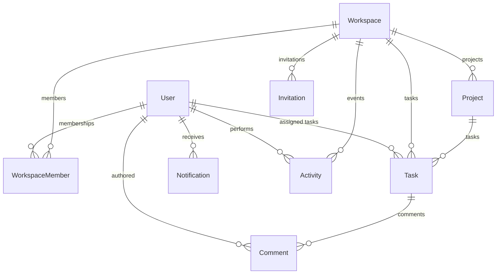

# WorkDesk

WorkDesk is a small project and task-management app built with JavaScript, the
Next.js App Router, React, Tailwind CSS, Prisma ORM 7, and SQLite.

## Run locally

Requirements: Node.js 24 LTS or a newer supported release, and npm.

```bash
npm install
npm run db:deploy
npm run dev
```

Open [http://localhost:3000](http://localhost:3000). The development command
generates Prisma Client before starting Next.js.

When changing `prisma/schema.prisma`, create and apply a development migration:

```bash
npm run db:migrate -- --name describe_your_change
```

The local database is `prisma/workdesk.db`. It is ignored by Git and remains on
disk when the app or development server restarts.

## How task creation works

1. The form in `app/components/Form.js` collects task fields on the All
   Tasks page (`app/tasks/page.js`).
2. `app/components/TaskManagement.js` sends them with `fetch()` to `POST /api/tasks`.
3. `app/api/tasks/route.js` validates the request and calls Prisma Client.
4. Prisma uses the SQLite adapter in `app/lib/prisma.js` to save the task.
5. The API returns the saved task; the task page updates its React state.
   The Overview and other read-only pages fetch the saved task list through
   `app/lib/useTasks.js`.

The same API is used for task loading (`GET /api/tasks`), edits and status
changes (`PATCH /api/tasks/[id]`), and deletion (`DELETE /api/tasks/[id]`).

## Pages and preferences

- `/` shows database-backed statistics, recent tasks, and the priority summary.
- `/projects` provides project creation, editing, search, status filtering,
  sorting, and archiving.
- `/projects/[id]` shows a project's schedule, task progress, and task register.
- `/tasks` provides task creation, editing, deletion, title/description search,
  status, priority, and project filters, sorting, quick status updates, project
  assignment, and task details.
- `/upcoming` separates overdue, due-soon (today through the next seven days),
  later upcoming, and undated tasks.
- `/analytics` summarizes status and priority counts from saved tasks.
- `/settings` controls browser-local appearance, display density, default task
  priority, delete confirmation, and display name.

`app/components/Sidebar.js` uses Next.js links for navigation. The shared
`PreferencesProvider` stores preferences in this browser's `localStorage` and
applies theme and density choices across pages. These settings are not tied to
an account and do not sync between browsers. Task insights are calculated from
the list returned by the database-backed task API; no sample statistics are
hardcoded.

## Project Structure

```text
WorkDesk/
├── app/
│   ├── api/
│   │   ├── projects/
│   │   │   ├── [id]/
│   │   │   └── route.js
│   │   └── tasks/
│   │       ├── [id]/
│   │       └── route.js
│   ├── components/
│   │   ├── TaskForm.js
│   │   ├── TaskManagement.js
│   │   ├── Sidebar.js
│   │   └── ...
│   ├── lib/
│   │   ├── prisma.js
│   │   └── useTasks.js
│   ├── projects/
│   ├── tasks/
│   ├── upcoming/
│   ├── analytics/
│   ├── settings/
│   └── page.js
├── generated/
│   └── prisma/
├── prisma/
│   ├── migrations/
│   ├── schema.prisma
│   └── workdesk.db
├── public/
├── tests/
├── prisma.config.mjs
├── package.json
└── README.md
```

## Projects and task relationships

Each `Project` has many `Task` records, while each task can belong to zero or
one project. `Task.projectId` is a nullable foreign key, so existing tasks stay
unassigned after the Projects migration. Archiving only changes the project's
status; it does not delete or detach tasks. A project can be edited to restore
it from the archived status.

The database relationship is defined in `prisma/schema.prisma`. The non-
destructive migration in `prisma/migrations/20261116152458_add_projects/`
creates the Project table and copies all existing task columns into the new
table shape, leaving `projectId` null. The foreign key uses `ON DELETE SET NULL`
as an additional safeguard if a project is removed outside the application.
The application itself does not provide permanent project deletion.

Project APIs are `GET`/`POST /api/projects` and `GET`/`PATCH /api/projects/[id]`.
Task APIs accept optional `projectId` values (or `null` to unassign a task).
Project and task request fields are validated on the server.

## Database setup

- `prisma/schema.prisma` describes `Project`, `Task`, their relationship, and
  their enums/defaults.
- `prisma.config.mjs` points Prisma CLI commands at the schema, migrations, and
  local SQLite file.
- `prisma/migrations/` contains SQL migrations generated by Prisma.
- `app/lib/prisma.js` reuses one Prisma Client instance during development.
- `generated/prisma/` is generated code and is not committed.

The browser only calls the API. It does not import Prisma or connect directly
to SQLite.

When developing against an existing database, create and apply a migration:

```bash
npm run db:migrate -- --name describe_your_change
```

For an existing deployment, apply committed migrations with
`npm run db:deploy`.

## API fields

- `title`: required, trimmed string (up to 100 characters).
- `priority`: `LOW`, `MEDIUM`, or `HIGH` (defaults to `MEDIUM`).
- `status`: `TODO`, `IN_PROGRESS`, or `DONE` (defaults to `TODO`).
- `description`: optional, trimmed string (up to 1,000 characters).
- `dueDate`: optional, valid `YYYY-MM-DD` calendar date.
- `projectId`: optional CUID for a project, or `null` for an unassigned task.
- `createdAt` and `updatedAt`: maintained by Prisma.

Projects require a non-empty `name`; description, status, start date, and due
date are validated by the project API. A start date cannot be later than its
due date.

## Validation and tests

The form checks values to provide immediate feedback, and the task API validates
them again before writing to SQLite. Task insight calculations and input
validation have focused tests. Run them with:

```bash
npm test
npm run lint
npm run build
```

## Deployment notes

The SQLite database is a local file at `prisma/workdesk.db`; database files are
ignored by Git, and no credentials or environment variables are currently
required. The local SQLite URL is configured in both `prisma.config.mjs` and
`app/lib/prisma.js`. This setup is for local development. A production host must
provide durable, writable storage for SQLite and keep both URLs pointed at the
same database file. Ephemeral/serverless filesystems can lose the database when
instances restart, so use a persistent volume or a database service supported
by the chosen host. Apply migrations with `npm run db:deploy` before starting
the production server.

## V2 features

WorkDesk V2 adds multi-workspace collaboration on top of the task register:

- Workspaces (personal and team) with workspace-scoped projects and tasks.
- Workspace membership with roles: `ADMIN`, `MANAGER`, `MEMBER`.
- Role hierarchy: `ADMIN > MANAGER > MEMMBER`, enforced server-side.
- Invitations with expiring, single-use tokens and role-scoped acceptance.
- Task assignment to workspace members.
- Comments on tasks with author-only edit and author-or-admin delete.
- Server-generated notifications (task assigned, comment added, mention, invitation received).
- Activity logging for task and comment changes.
- Projects with schedule, progress, and a task register.

## Architecture



Role hierarchy: `ADMIN (3) > MANAGER (2) > MEMBER (1)`. A user may have a
different role in each workspace.

## Environment variables

Copy `.env.example` to `.env` and adjust:

| Variable | Description | Default |
|----------|-------------|---------|
| `DATABASE_URL` | Prisma datasource URL for SQLite | `file:./prisma/workdesk.db` |

No other credentials or environment variables are required for local
development.

## Database setup and migrations

```bash
npm install
npm run db:generate      # generate Prisma Client
npm run db:deploy        # apply committed migrations
npm run dev              # start the dev server (runs prisma generate first via predev)
```

The local database is `prisma/workdesk.db` (SQLite). It is ignored by Git and
persists across restarts. Schema changes require a new development migration:

```bash
npm run db:migrate -- --name describe_your_change
```

### Backup and recovery

The database is a single SQLite file at `prisma/workdesk.db`. To back it up,
copy the file (and any `-wal`/`-shm` sidecar files if present) to durable
storage:

```bash
# example: one-off backup
cp prisma/workdesk.db backups/workdesk-$(date +%F).db
```

To restore, stop the server, replace `prisma/workdesk.db` with the backup,
then restart and run `npm run db:deploy` to confirm migrations are applied.

## Deployment

This is a local-first SQLite application. A production host must provide
durable, writable storage for the SQLite file so it survives instance
restarts; ephemeral/serverless filesystems will lose data. Use a persistent
volume or a managed database service supported by the host, and keep
`DATABASE_URL` (and `app/lib/prisma.js`) pointed at the same database file.

Before starting the production server:

```bash
npm run db:generate
npm run db:deploy
npm start
```

## Security notes and known limitations

**Authentication is not yet implemented.** There are no registration, login,
logout, or session-expiration routes and no `Session` model. API routes
identify the caller through a `userId` query parameter, which can be spoofed,
and `GET /api/tasks` without parameters returns every task across all
workspaces. Treat this as a **release blocker**: before any deployment that
exposes the API, add session-based authentication (cookie or bearer token)
and a middleware that resolves the caller from the session rather than from
user-controlled query input, scope every list endpoint to the caller's
workspace(s), and add CSRF protection for state-changing mutations.

Other security characteristics:
- API error responses return only generic messages; detailed errors go to
  server logs (`console.error`). Do not forward those logs to clients.
- Invitations use 256-bit cryptographically random tokens and expire after 7
  days by default.
- Comment author and notification recipient are always set server-side from
  the verified caller, never from the request body.

Accessibility: pages use `aria-label`, `aria-labelledby`, `role="alert"`,
`role="status"`, `role="progressbar"`, `aria-current="page"`, `sr-only`
labels, and visible `focus-visible` outlines. The layout is responsive with
breakpoints at 960px, 700px, and 420px, plus `prefers-reduced-motion` support.

## Testing

Unit and integration tests run with Node's built-in test runner:

```bash
npm test      # unit + lib integration tests
npm run lint  # ESLint
npm run build # production build + TypeScript check
```

Tests cover role hierarchy, workspace/task access enforcement, comment
permissions, notification building and delivery, invitation tokens and expiry,
and project/task validation. There are no end-to-end browser tests yet.

## WorkDesk V2 entry flows

- Registration creates an account and personal workspace, then opens the
  four-step onboarding flow (workspace choice, profile, invitations, first
  project). Existing accounts go straight to their last active workspace.
- Login supports email/password, a password visibility toggle, optional
  "remember me", and hashed, single-use password reset links.
- The workspace switcher separates personal and team workspaces, remembers the
  active workspace on the server session, and scopes page data to it.
- My Tasks shows assignments across accessible workspaces; Team shows member
  workload with drill-down and reassignment.
- Invitations are single-use links with expiry, status, resend and revoke. No
  email is sent unless `INVITATION_WEBHOOK_URL` is configured.
- `GET /api/health` provides a database-backed health check.

## Documentation and operations

See `docs/ARCHITECTURE.md`, `docs/SECURITY.md`, `docs/TESTING.md`,
`docs/DEPLOYMENT.md` and `docs/DATABASE.md` for detailed notes. Environment
variables are listed in `.env.example`. SQLite is the current database; a
managed PostgreSQL migration is still required before internet-facing
multi-user deployment. CI runs lint, tests and build on push and pull request.
