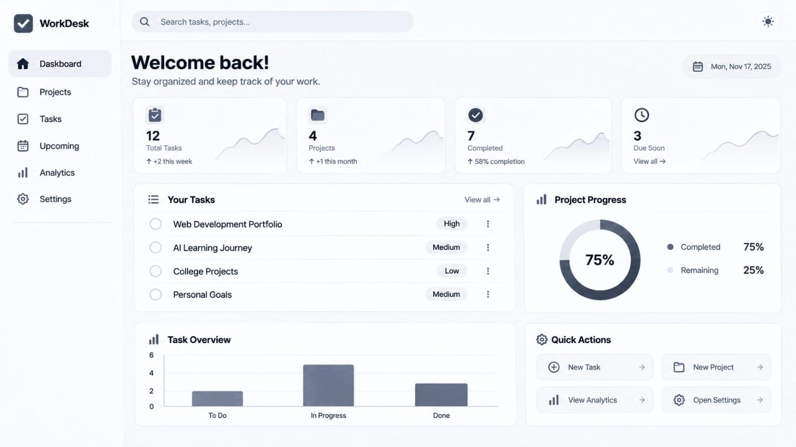
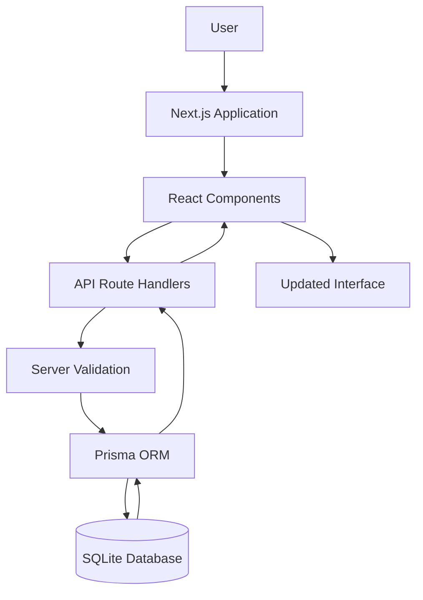
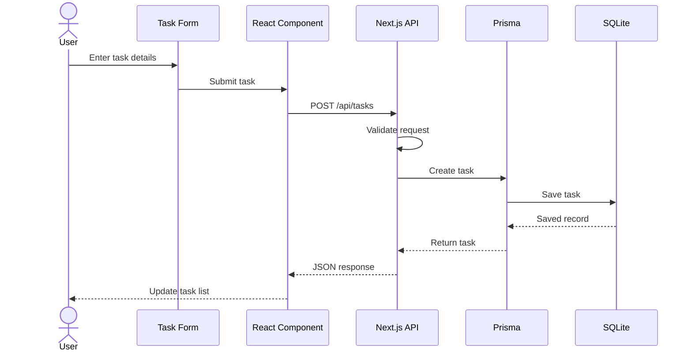
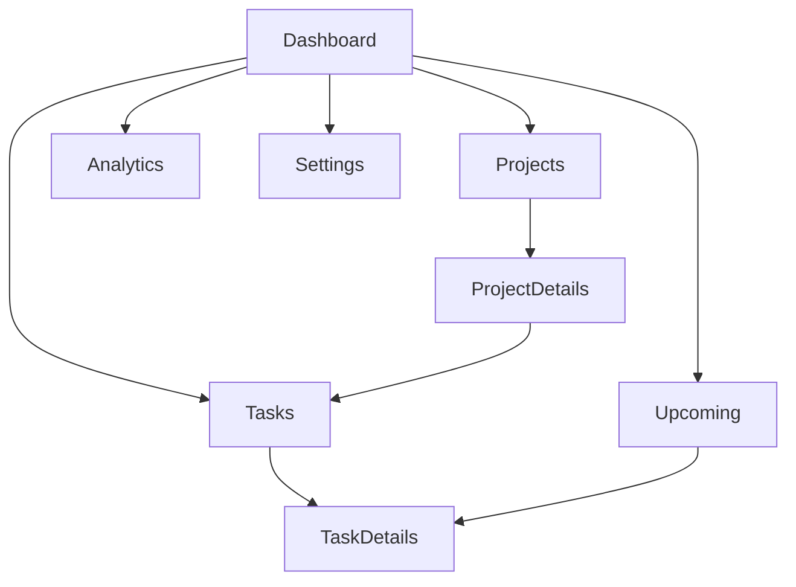
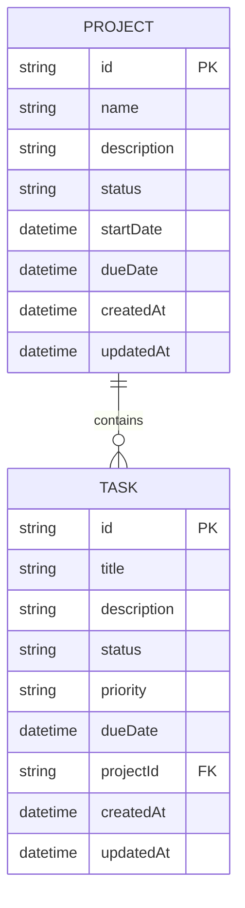

# WorkDesk

<p align="center">
  <strong>A Simple Workspace for Projects and Tasks</strong>
  <br />
  Organize projects, manage tasks, and track progress in one place.
</p>

<p align="center">
  
  
  
  
  
  
</p>

---

## Product Preview

<p align="center">
  
</p>

<p align="center">
  <sub>AI-generated visual concept of WorkDesk.</sub>
</p>

---

## Overview

WorkDesk is a lightweight project and task management application built to provide a centralized workspace for organizing projects, managing daily tasks, tracking deadlines, and monitoring progress.

The application uses Next.js and React for the frontend, API route handlers for backend operations, Prisma ORM for database access, and SQLite for local data persistence.

### Core Objectives

- Organize projects in one place.
- Manage tasks and priorities.
- Track deadlines and upcoming work.
- Monitor project progress.
- Review task statistics and productivity insights.

## Features

### Dashboard
- Overview of saved task statistics.
- Recent task activity.
- Priority distribution summary.
- Database-backed task insights.

### Project Management
- Create and edit projects.
- Search projects by name.
- Filter and sort projects.
- Archive and restore projects.
- View individual project details.
- Monitor project schedules and task progress.

### Task Management
- Create, edit, and delete tasks.
- Search tasks by title and description.
- Filter by status, priority, and project.
- Sort task listings.
- Update task status.
- Assign tasks to projects or leave them unassigned.
- Set optional due dates.
- View individual task details.

### Upcoming Tasks
Tasks are organized into four categories:

| Category | Description |
|---|---|
| Overdue | Past-due tasks that remain incomplete |
| Due Soon | Tasks due today or within seven days |
| Later | Tasks scheduled beyond seven days |
| No Due Date | Tasks without a deadline |

### Analytics
- Task status distribution.
- Priority distribution.
- Statistics based on saved task records.

### Settings
- Appearance preferences.
- Display density.
- Default task priority.
- Delete confirmation preference.
- Display name customization.

Settings are stored in browser localStorage and are not synchronized between accounts or browsers.

## Application Pages

| Page | Route | Description |
|---|---|---|
| Dashboard | `/` | Overview of projects and tasks |
| Projects | `/projects` | Project organization |
| Project Details | `/projects/[id]` | Individual project information |
| Tasks | `/tasks` | Task management |
| Upcoming | `/upcoming` | Deadline organization |
| Analytics | `/analytics` | Task statistics |
| Settings | `/settings` | Application preferences |

## Technology Stack

| Technology | Purpose |
|---|---|
| JavaScript | Application language |
| Next.js App Router | Application framework |
| React | User interface |
| Tailwind CSS | Styling |
| Prisma ORM 7 | Database access |
| SQLite | Relational database |
| Node.js | Runtime environment |
| npm | Package management |

---

## Architecture

WorkDesk follows a layered architecture. The frontend communicates with backend API routes, which validate requests and use Prisma to interact with SQLite.

### System Architecture



### Task Creation Workflow



### Application Navigation



## Database Design

WorkDesk uses two primary relational models: `Project` and `Task`.

### Entity Relationship Diagram



### Database Relationships

- One project can contain multiple tasks.
- A task belongs to zero or one project.
- `Task.projectId` is nullable.
- Unassigned tasks are supported.
- Archiving a project does not delete its tasks.

### Task Fields

| Field | Description |
|---|---|
| `title` | Required task title |
| `description` | Optional description |
| `status` | TODO, IN_PROGRESS, DONE |
| `priority` | LOW, MEDIUM, HIGH |
| `dueDate` | Optional deadline |
| `projectId` | Optional project relationship |
| `createdAt` | Creation timestamp |
| `updatedAt` | Last update timestamp |

Default status is `TODO`, and default priority is `MEDIUM`.

---

## API Reference

### Task Endpoints

| Method | Endpoint | Description |
|---|---|---|
| GET | `/api/tasks` | Retrieve tasks |
| POST | `/api/tasks` | Create a task |
| PATCH | `/api/tasks/[id]` | Update a task |
| DELETE | `/api/tasks/[id]` | Delete a task |

### Project Endpoints

| Method | Endpoint | Description |
|---|---|---|
| GET | `/api/projects` | Retrieve projects |
| POST | `/api/projects` | Create a project |
| GET | `/api/projects/[id]` | Retrieve project details |
| PATCH | `/api/projects/[id]` | Update a project |

Incoming data is validated by backend API routes before database operations.

## Project Structure

```text
WorkDesk/
├── app/
│   ├── api/
│   │   ├── projects/
│   │   │   ├── [id]/
│   │   │   └── route.js
│   │   └── tasks/
│   │       ├── [id]/
│   │       └── route.js
│   ├── components/
│   ├── lib/
│   │   ├── prisma.js
│   │   └── useTasks.js
│   ├── projects/
│   ├── tasks/
│   ├── upcoming/
│   ├── analytics/
│   ├── settings/
│   └── page.js
├── generated/
│   └── prisma/
├── prisma/
│   ├── migrations/
│   └── schema.prisma
├── public/
├── tests/
├── prisma.config.mjs
├── package.json
└── README.md
```

This is a simplified overview. Generated files and local database files may not be committed.

## Getting Started

### Prerequisites

- Node.js 24 LTS or a newer supported release.
- npm.
- Git.

### 1. Clone the Repository

```bash
git clone https://github.com/Shibanhafiz/WorkDesk.git
```

### 2. Navigate to the Project

```bash
cd WorkDesk
```

### 3. Install Dependencies

```bash
npm install
```

### 4. Initialize the Database

```bash
npm run db:deploy
```

### 5. Start the Development Server

```bash
npm run dev
```

### 6. Open the Application

Visit:

`http://localhost:3000`

## Database Management

### Apply Existing Migrations

```bash
npm run db:deploy
```

### Create a New Migration

```bash
npm run db:migrate -- --name describe_your_change
```

### Open Prisma Studio

```bash
npm run db:studio
```

The local database is stored at `prisma/workdesk.db` and is ignored by Git.

## Testing and Code Quality

### Run Tests

```bash
npm test
```

### Run ESLint

```bash
npm run lint
```

### Production Build

```bash
npm run build
```

## Deployment Considerations

WorkDesk currently uses a local SQLite database.

For production deployment:

- Use durable, writable storage.
- Configure the database URL correctly.
- Ensure the application and Prisma use the same database location.
- Apply committed migrations before starting the application.
- Avoid temporary filesystems for persistent database storage.

A persistent volume or suitable database service is necessary for reliable production data storage.

## WorkDesk V2 entry flows

- Registration creates an account and personal workspace, then opens the
  four-step onboarding flow (workspace choice, profile, invitations, first
  project). Existing accounts go straight to their last active workspace.
- Login supports email/password, a password visibility toggle, optional
  "remember me", and hashed, single-use password reset links.
- The workspace switcher separates personal and team workspaces, remembers the
  active workspace on the server session, and scopes page data to it.
- My Tasks shows assignments across accessible workspaces; Team shows member
  workload with drill-down and reassignment.
- Invitations are single-use links with expiry, status, resend and revoke. No
  email is sent unless `INVITATION_WEBHOOK_URL` is configured.
- `GET /api/health` provides a database-backed health check.

## Current limitations and remaining setup

- The local database is SQLite. A managed PostgreSQL migration is required
  before internet-facing multi-user deployment.
- Email delivery, email verification and OAuth are not configured; no provider
  is claimed as active.
- The in-memory rate limiter needs a shared store for multi-instance hosting.
- No browser automation suite or Lighthouse audit is included yet.
- Permanent project deletion through the UI is intentionally not provided.

## Documentation and operations

See `docs/ARCHITECTURE.md`, `docs/SECURITY.md`, `docs/TESTING.md`,
`docs/DEPLOYMENT.md` and `docs/DATABASE.md` for detailed notes. Environment
variables are listed in `.env.example`. CI runs lint, tests and build on push
and pull request.

## Learning Outcomes

WorkDesk demonstrates practical experience with:

- React components and state management.
- Next.js App Router.
- Dynamic routing.
- Frontend and backend communication.
- API development and CRUD operations.
- Server-side validation.
- Relational database design.
- Prisma ORM and SQLite.
- Database migrations.
- Testing and code quality.

---

## Author

**Shiban Hafiz**

B.E. Artificial Intelligence and Machine Learning Student

- GitHub: [@Shibanhafiz](https://github.com/Shibanhafiz)
- Portfolio: [Portfolio Website](https://shibanhafiz-portfolio.vercel.app/)
- Repository: [WorkDesk](https://github.com/Shibanhafiz/WorkDesk)

---

<p align="center">
  <strong>WorkDesk</strong>
  <br />
  Organize projects. Manage tasks. Track progress.
</p>
